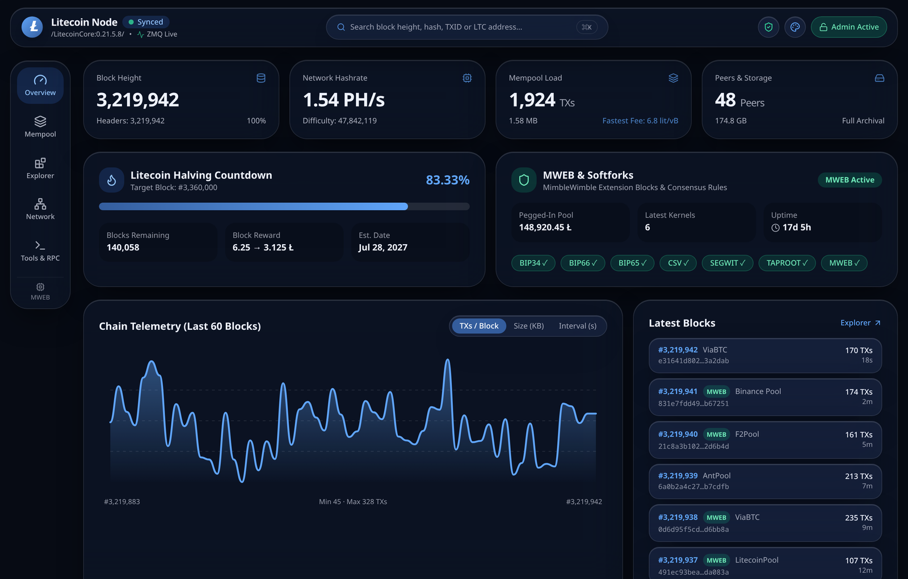
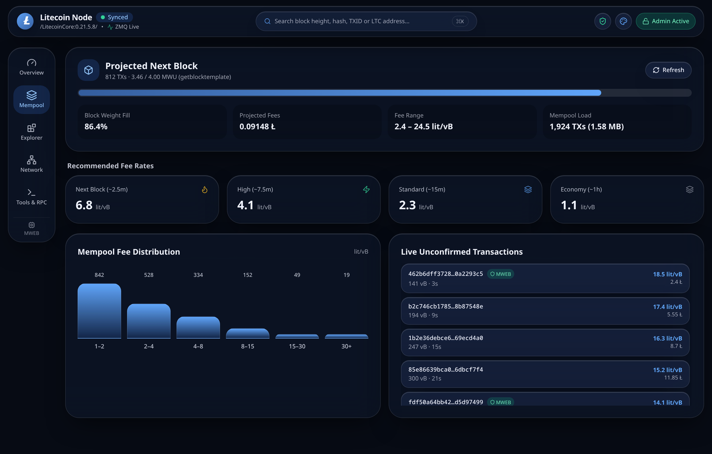
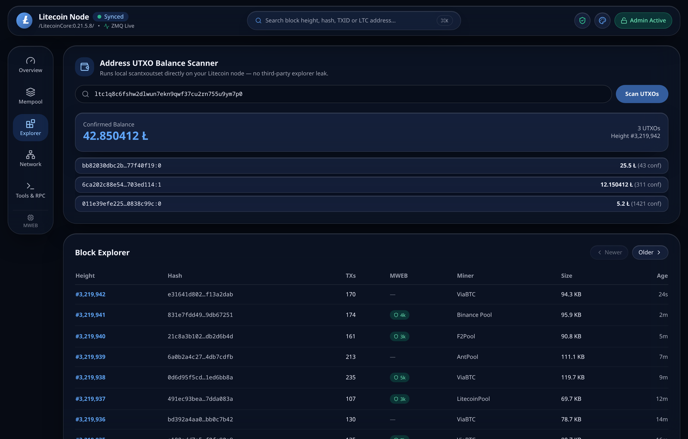
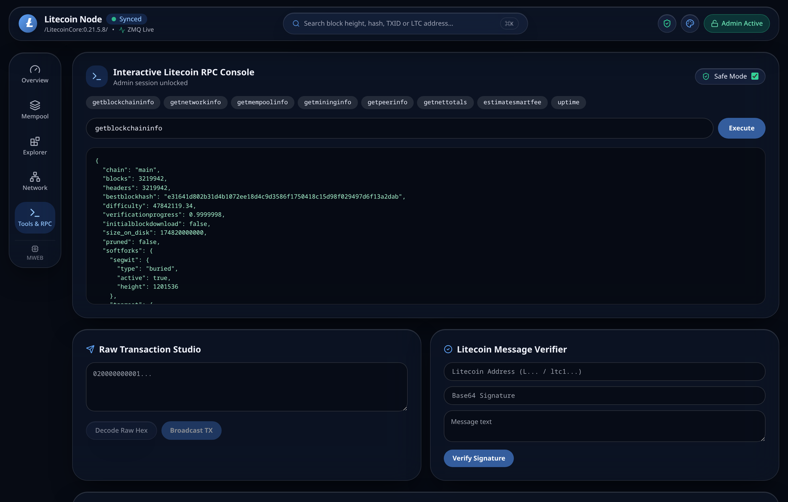
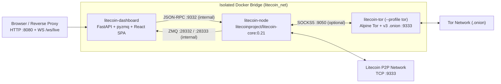

# Litecoin Node — Material 3 Glass Suite

[](https://github.com/litecoin-foundation/umbrel-docker-scripts/actions/workflows/ci.yml)
[](https://litecoin.org/)
[](https://docs.docker.com/compose/)
[](#system-requirements)
[](LICENSE)

A standalone, open-source **2-container Docker Compose stack** for running a full **Litecoin Core (`0.21` + MWEB)** node paired with a unified **Material 3 Expressive Frosted Glass** dashboard, real-time ZMQ WebSocket updates, local block/transaction/UTXO explorer, mempool fee analyzer, and admin-protected RPC terminal.

---

## Screenshots



| Mempool & Fee Estimator | Block & Local UTXO Explorer | Interactive RPC Studio & Node Tools |
| :---: | :---: | :---: |
|  |  |  |

---

## Highlights

- **Simple 2-Container Architecture**: Only `litecoin-node` (`litecoinproject/litecoin-core:0.21`) and `litecoin-dashboard` (`FastAPI` + `pyzmq` + `React 19 / Vite`) on a single web port (`8080`).
- **Material 3 Frosted Glass UI**: Dark & Light Glass themes with 4 dynamic M3 accent seeds (*Litecoin Cobalt*, *Silver Glass*, *MWEB Emerald*, *Amethyst*), responsive desktop Navigation Rail & mobile floating bar.
- **Zero External CDN / Zero Tracking by Default**: All styling, vector icons, and interactive SVG charts are self-hosted inside the container. Optional LTC market price & peer GeoIP lookups are strictly opt-in from the **Privacy Shield** menu.
- **2-Stage Live IBD Telemetry**: Automatically tracks **Stage 1** (Headers-First Sync against live peer `startingheight`) and **Stage 2** (Block Validation) with rolling speed (`hdr/s` & `blk/s`) and ETA.
- **ZMQ Real-Time Stream**: Subscribes directly to `litecoind` `pubhashblock` & `pubhashtx` over ZeroMQ and pushes live events to the browser via WebSockets (`/ws/live`).
- **Smart-Auth & Non-Custodial**: Runs with `-disablewallet=1` (no private keys on the server). Read-only node telemetry and explorer are viewable immediately (or lockable via `LOCK_ENTIRE_DASHBOARD=true`), while RPC Console, Peer Ban/Disconnect/Add, and Raw TX Broadcast require your `ADMIN_PASSWORD`.

---

## Architecture



---

## Feature Modules

1. **Overview & Halving Countdown**:
   - Real-time 2-stage sync banner (`Headers` vs `Blocks`) with rolling-window speed and ETA.
   - Network-tip-aware **Litecoin Halving Countdown** (`#3,360,000`, `6.25 Ł → 3.125 Ł`).
   - **MWEB** (MimbleWimble Extension Blocks) & **BIP8/BIP9** softfork status (`segwit`, `mweb`, `taproot`, `csv`).
   - Interactive 60-block telemetry charts (*TXs / Block*, *Size KB*, *Block Interval*) + ZMQ live block feed.
2. **Mempool & Fee Estimator**:
   - **Projected Next Block** weight fill bar & total fee estimate (`getblocktemplate` with mempool packing fallback).
   - 4 Smart Fee priority cards (*Next Block*, *High*, *Standard*, *Economy*) in `lit/vB`.
   - Fee rate distribution histogram and live unconfirmed transaction stream.
3. **Block, TX & UTXO Explorer (`⌘K` / `Ctrl+K`)**:
   - Global command palette to jump directly to a block height, block hash, TXID, or LTC address.
   - Paginated block explorer with coinbase ASCII miner pool tag decoding and MWEB kernel counts.
   - MWEB HogEx-aware Transaction Inspector with batch input/fee resolution and Genesis/non-`txindex` block fallback.
   - Local **Address UTXO Balance Scanner** (`scantxoutset`) running directly on your node — zero third-party explorer leaks.
4. **Network, Peers & Privacy**:
   - Clearnet, SOCKS5 proxy, and Tor v3 `.onion:9333` connectivity status with 1-click `.onion` copy.
   - Cumulative upload/download metrics with live session bandwidth sparkline.
   - Searchable peer table with client subversion, ping bars, sync height, optional GeoIP flags, and admin **Add / Disconnect / Ban (24h)** controls.
5. **Node Tools & RPC Console**:
   - Interactive Litecoin Core RPC terminal with command catalog chips, arrow-key history (`↑`/`↓`), and **Safe Mode** guard.
   - **Raw Transaction Studio** (`decoderawtransaction` + admin-protected `sendrawtransaction`).
   - **Message Signature Verifier** (`verifymessage`) and interactive `litecoin.conf` generator.

---

## System Requirements

| Mode | `.env` Setting | Disk Space | RAM | CPU Architecture |
| :--- | :--- | :--- | :--- | :--- |
| **Full Archival (`txindex=1`)** | `PRUNE_MB=0` | ~200+ GB SSD | 2 GB min (4 GB+ recommended) | `linux/amd64`, `linux/arm64` |
| **Pruned Node** | `PRUNE_MB=10000` | ~15 GB SSD | 2 GB min (4 GB+ recommended) | `linux/amd64`, `linux/arm64` |

---

## Quickstart

```bash
# 1. Clone the repository
git clone https://github.com/litecoin-foundation/umbrel-docker-scripts.git
cd umbrel-docker-scripts

# 2. Configure environment
cp .env.example .env
# Edit .env and set strong RPC_PASSWORD and ADMIN_PASSWORD values

# 3. Build & start the 2-container stack
docker compose up -d --build

# 4. Open the Material 3 Glass Dashboard
# http://localhost:8080
```

---

## Privacy & Proxy Modes

### Option A: Built-in Tor v3 Hidden Service & SOCKS5 Sidecar

Enable the optional Tor container to route outbound P2P traffic over Tor and expose a private v3 `.onion:9333` Hidden Service (automatically surfaced in the **Network** tab):

1. Set in `.env`:
   ```env
   SOCKS5_PROXY=tor:9050
   # Optional: restrict P2P connections exclusively to .onion peers
   ONLYNET_ONION=false
   ```
2. Start with the `tor` profile:
   ```bash
   docker compose --profile tor up -d --build
   ```

### Option B: External SOCKS5 / VPN Container (e.g. Gluetun)

Point `SOCKS5_PROXY` in `.env` to any reachable SOCKS5 endpoint (for example `gluetun:1080` on a shared Docker network):

```env
SOCKS5_PROXY=gluetun:1080
```

Both `litecoind` P2P traffic and any opt-in dashboard lookups (LTC market ticker / GeoIP) will route through `SOCKS5_PROXY`.

---

## Configuration (`.env`)

| Variable | Default | Description |
| :--- | :--- | :--- |
| `LITECOIN_VERSION` | `0.21` | Official `litecoinproject/litecoin-core` image tag |
| `LITECOIN_P2P_PORT` | `9333` | Host TCP port for Litecoin P2P |
| `LITECOIN_DATA_DIR` | `./data/litecoin` | Persistent blockchain data directory |
| `RPC_USER` | `litecoin` | Internal JSON-RPC username |
| `RPC_PASSWORD` | `CHANGE_ME...` | Internal JSON-RPC password |
| `DB_CACHE` | `1024` | LevelDB / UTXO cache size in MB (increase during IBD if RAM allows) |
| `MAX_CONNECTIONS` | `125` | Maximum P2P peer connections |
| `MAX_MEMPOOL` | `300` | Maximum mempool RAM usage in MB |
| `PRUNE_MB` | `0` | `0` = full archival (`txindex=1` + `blockfilterindex=1`), `>0` = pruned MB |
| `SOCKS5_PROXY` | *(empty)* | Optional SOCKS5 proxy (`tor:9050` or external `host:port`) |
| `ONLYNET_ONION` | `false` | Restrict `litecoind` P2P exclusively to `.onion` peers |
| `DASHBOARD_PORT` | `8080` | Web UI & API port exposed on the host |
| `ADMIN_PASSWORD` | `CHANGE_ME...` | Password protecting RPC Console, Peer management & Raw TX Broadcast |
| `LOCK_ENTIRE_DASHBOARD` | `false` | Require `ADMIN_PASSWORD` login before viewing any dashboard page |

---

## Security Architecture

- **Non-Custodial**: `litecoind` starts with `-disablewallet=1`; no wallet files or private keys ever exist on the node.
- **No Exposed RPC or ZMQ Ports**: Ports `9332` (JSON-RPC) and `28332`/`28333` (ZMQ) are bound strictly inside the private `litecoin_net` Docker network.
- **Smart-Auth**: Administrative mutations (`/api/rpc/exec`, `/api/peers/*`, `/api/tx/broadcast`) require an HMAC-SHA256 bearer token issued via `ADMIN_PASSWORD`.
- **RPC Safe Mode**: Blocks destructive/wallet commands (`stop`, `dumpprivkey`, `dumpwallet`, `backupwallet`, `encryptwallet`) by default in the RPC terminal.

---

## Operations & Reverse Proxy

### Common Management Commands

```bash
# View container health & status
docker compose ps

# Follow Litecoin Core sync logs
docker compose logs -f litecoind

# Run litecoin-cli directly inside the node container
docker exec litecoin-node litecoin-cli -rpcuser=litecoin -rpcpassword=YOUR_RPC_PASS getblockchaininfo

# Update & rebuild containers
docker compose pull && docker compose up -d --build
```

### Nginx Reverse Proxy (with WebSocket `/ws/live`)

If exposing the dashboard behind Nginx with TLS:

```nginx
location / {
    proxy_pass http://127.0.0.1:8080;
    proxy_http_version 1.1;
    proxy_set_header Upgrade $http_upgrade;
    proxy_set_header Connection "upgrade";
    proxy_set_header Host $host;
    proxy_set_header X-Forwarded-For $proxy_add_x_forwarded_for;
    proxy_set_header X-Forwarded-Proto $scheme;
}
```

---

## Project Structure

```text
.
├── docker-compose.yml              # 2-container stack + optional Tor profile
├── .env.example                    # Environment configuration template
├── LICENSE                         # MIT License
├── docker/
│   ├── litecoin/start-litecoind.sh # .env -> litecoind CLI flags wrapper
│   └── tor/                        # Optional Alpine Tor SOCKS5 + v3 Hidden Service
└── dashboard/
    ├── Dockerfile                  # Multi-stage Node 22 + Python 3.12 build
    ├── backend/app/                # FastAPI, async JSON-RPC, pyzmq, Smart-Auth
    └── frontend/src/               # React 19 + TypeScript + Vite Material 3 Glass UI
```

---

## License

Released under the [MIT License](LICENSE).
